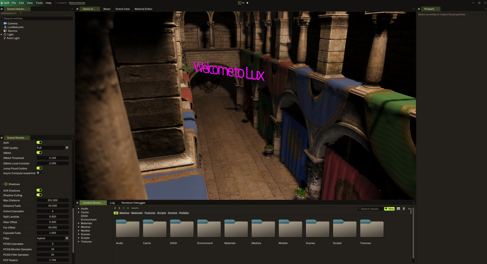
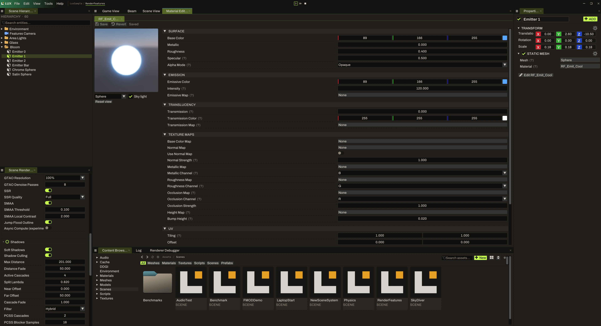

# Finding your way around the editor

The editor is one native window drawn with Dear ImGui (the docking branch) on top of the engine's Vulkan renderer. Every panel is a small class registered with a panel manager, which remembers which panels you had open. This page covers what you'll use every day. The engine repository has the full [editor manual](https://github.com/starbounded-dev/LuxEngine/tree/dev/docs/Editor), with file and line references for each part.

These are captures of a development build from the [`dev` branch](https://github.com/starbounded-dev/LuxEngine/tree/dev). Layouts and panel names can change between revisions.

## Edit, Play and Simulate

The buttons in the middle of the title bar switch the scene between three states.

- **Edit** is where you start. You're changing the scene you'll save, the editor camera flies freely, and nothing simulates.
- **Play** copies the scene and runs the copy, with scripts and physics. Press Stop and the editor goes back to the untouched original, so nothing you change during Play survives. Debug views like wireframe and colliders are switched off for the session and come back on Stop.
- **Simulate** runs physics without scripts. It's for checking how things fall and collide without game logic getting in the way.

The same cluster holds the gizmo tools, and it sits in the title bar rather than over the viewport, so it stays reachable when another tab covers the scene.

## Two layouts

The editor has two dock arrangements, toggled from the title bar's context menu (**Switch to Simple Mode**):

- **Simple**: the viewport, the scene hierarchy, the content browser and the log. Enough for building a scene.
- **Advanced**: adds the diagnostic panels, such as the Scene Renderer settings, the Renderer Debugger and the Profiler.

**View → Reset Layout** rebuilds the current arrangement if you've dragged things somewhere unhelpful. The View menu also has a toggle for every panel.

## Moving the camera

The viewport camera has two modes. Which one you're in depends on whether you hold **Alt**.

**Fly**, with the right mouse button held:

| Input | Action |
| --- | --- |
| **W / S** | Forward and back |
| **A / D** | Left and right |
| **Q / E** | Down and up |
| Mouse | Look around |
| Scroll | Change the fly speed |
| **Shift** / **Ctrl** | Move faster / slower |

**Orbit**, with **Alt** held:

| Input | Action |
| --- | --- |
| **Alt + left drag** | Orbit around the focal point |
| **Alt + middle drag** | Pan |
| **Alt + right drag** | Dolly |
| Scroll | Zoom |

A left click on the scene, without Alt and not on a gizmo, selects whatever is under the cursor. When the render resolution and the panel have different shapes, the image is letterboxed rather than stretched, and picking still lines up with what you see.

## Gizmos and snapping

| Key | Gizmo |
| --- | --- |
| **Q** | None |
| **W** | Move |
| **E** | Rotate |
| **R** | Scale |

Hold **Ctrl** while dragging to snap: 0.5 units for moves, 45° for rotations. The keys are ignored while you're mid-drag. The gizmos are ImGuizmo.

## Shortcuts

| Shortcut | Action |
| --- | --- |
| **Ctrl+N** | New scene |
| **Ctrl+O** | Open project |
| **Ctrl+S** / **Ctrl+Shift+S** | Save scene / save as |
| **Ctrl+D** | Duplicate the selected entity |
| **Ctrl+Z** | Undo |
| **Ctrl+Shift+Z** or **Ctrl+Y** | Redo |
| **Ctrl+R** | Reload the C# script assembly |
| **Ctrl+Shift+R** | Reload every shader |
| **Ctrl+Shift+P** | Command palette |

The command palette is a fuzzy search over every menu action and panel. Type to filter, use the arrow keys to move, and Enter to run.

## The panels

| Panel | Open by default | What it's for |
| --- | --- | --- |
| Scene Hierarchy | yes | The entity tree on top and the selected entity's components below. Drag one row onto another to reparent. |
| Content Browser | yes | The project's assets, with a grid or list view, type filters, sorting, favourites and cached thumbnails. |
| Log | yes | Engine and script messages, tinted by level, with a filter. |
| Beam | yes | A multi-tab text editor for scripts and text files. Opening a `.cs` file in the Content Browser opens it here. |
| Scene Renderer | no | Every renderer setting for the scene: quality presets, culling, LODs, render scale, GTAO, SSR, SMAA, shadows, bloom, depth of field, exposure and tonemapping. |
| Light Settings | no | Sky, ambient light and the environment map. |
| Material Editor | no | Opens by itself when you open a material. See below. |
| Renderer Debugger | no | GPU time per render pass, with a frame history. |
| Profiler | no | CPU frame time against a 60 fps budget, plus the per-pass GPU timings. |
| Audio Debugger | no | The live audio stack. See [Audio](audio.md). |
| History | no | The undo stack, so you can see where you are in it. |
| Asset Manager | no | Every asset the project knows about, with its type and source path. |
| Project Settings | no | Physics layers, scripting, renderer defaults, audio and quality tiers for this project. |
| Application Settings | no | Editor-wide settings such as VSync and the target frame rate. |

## Undo and redo

Undo works in Edit mode on the scene you're editing. It covers inspector fields, renames, adding and removing components, gizmo moves, and deleting or duplicating entities. While a text field has focus, Ctrl+Z belongs to the text field instead.

Under the hood each step is a snapshot of the whole scene as YAML, taken when an edit finishes. That's simple and can't leave dangling pointers behind, but it costs more on very large scenes. The manual's [undo page](https://github.com/starbounded-dev/LuxEngine/blob/dev/docs/Editor/Undo-Redo.md) explains the trade-off and the plan to move to granular commands. Play and Simulate keep a separate, temporary history that's thrown away when you press Stop.

## Looking at a material

The capture shows `RF_Emit_Cool` open in the Material Editor, with `Emitter 1` selected in the hierarchy. The Properties panel lists that entity's transform and static mesh, and names its material.

The workspace has a preview on the left and the settings in the middle:

- **Surface:** base colour, metallic, roughness, specular and alpha mode.
- **Emission:** emissive colour, intensity and an emissive map.
- **Translucency:** transmission, transmission colour and a transmission map.
- **Texture maps:** base colour, normal, metallic, roughness, occlusion and height.
- **UV:** tiling and offset.

The preview has a shape selector, a sky light toggle and a reset-view button. Save, Revert and a saved-state label sit above it. Check that label before you leave a material, especially a sample one you were only experimenting with.

For a first comparison, note a material's starting values, change one surface or emission setting, and compare the preview with the scene. Put the value back before you try the next one. The [rendering guide](rendering.md) explains how to keep comparisons repeatable.

## When your editor looks different

Check which branch and commit you built before deciding a panel is missing. If something still looks wrong, open an [engine issue](https://github.com/starbounded-dev/LuxEngine/issues) with the revision and a screenshot. [Contributing](contributing.md) lists what makes a report easy to investigate.
