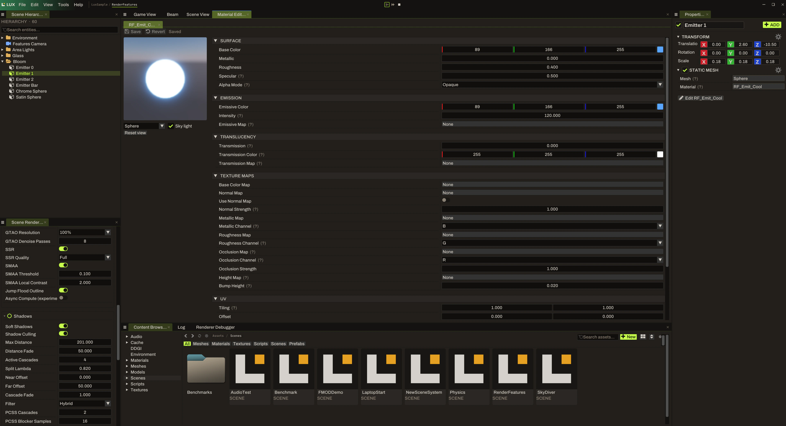

# Finding your way around the editor

LuxEngine brings the scene, assets, rendering settings, and material tools into one workspace. This guide uses the development screenshots below as a map of that workspace.

These are captures of a working development build, matching the engine's current [`dev` branch](https://github.com/starbounded-dev/LuxEngine/tree/dev). Panel layouts, names, and available features can vary by revision. The older `master` README uses some legacy names; follow the instructions for your checkout.

## The main panels

| Area | What to look for |
| --- | --- |
| Scene Hierarchy, on the left | The scene's entities, including the camera, Sponza model, lights, and text in this capture. A search field sits above the list. |
| Central workspace | Tabs labeled Game View, Beam, Scene View, and Material Editor. The Sponza scene is displayed in the active Game View tab. |
| Properties, on the right | The selected entity's settings. With no entity selected, the panel asks you to select one. |
| Content Browser, along the bottom | Asset folders and filters for meshes, materials, textures, scripts, scenes, and prefabs. The Log and Renderer Debugger tabs sit alongside it. |
| Scene rendering settings, lower left | Controls for the renderer, including anti-aliasing, reflections, and shadows in this capture. |

Start with a scene that is already included in your checkout. Find its camera and a light in the hierarchy, then select an entity and look at its Properties panel. This connects the objects in the viewport with their settings without requiring a new scene from scratch.

The Content Browser shows the assets in the project. Its folder tree, breadcrumb trail, type filters, and search field help narrow down what you are looking at. Folder names and available sample scenes depend on the checkout.

## Looking at a material

The material capture shows `RF_Emit_Cool` open in the Material Editor, with `Emitter 1` selected in the hierarchy. The Properties panel lists that entity's transform and static mesh, and names the material assigned to it.

The material workspace is divided into a preview on the left and groups of settings in the center:

- **Surface:** base color, metallic, roughness, specular, and alpha mode.
- **Emission:** emissive color, intensity, and an emissive map slot.
- **Translucency:** transmission, transmission color, and a transmission map slot.
- **Texture maps:** slots and controls for base color, normals, metallic, roughness, occlusion, and height.
- **UV:** tiling and offset values.

The preview includes a shape selector, a Sky light option, and a Reset view control. Save, Revert, and a saved-state label are visible above the material workspace. Check the state of your material before leaving it, especially when experimenting with a sample asset.

For a useful first comparison, note the material's starting values, change one surface or emission setting, and compare the preview with the scene. Restore the starting value before testing another control. The [rendering guide](rendering.md) describes how to keep comparisons repeatable.

## When the interface differs

Check the branch and commit you built before assuming a panel is missing. If the behavior still looks wrong, include that revision and a screenshot in an [engine issue](https://github.com/starbounded-dev/LuxEngine/issues). See [Contributing](contributing.md) for the details that make a report easier to investigate.
