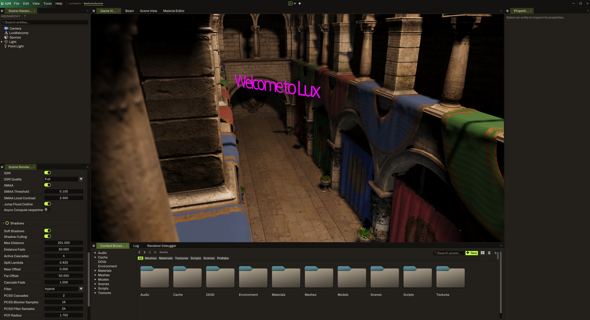

# LuxEngine docs

LuxEngine is a 3D game engine and editor from Starbounded, written in C++20 on Vulkan for Windows and Linux. These guides get you from a clean machine to a running editor, then explain what each part of the engine does and what it doesn't do yet.

The repository's default `master` branch still holds the older StarEngine project; ignore it.

!!! note "Before you start"
    You need the Vulkan SDK and .NET 10, and that's all: audio is built in. The newest work, which these guides describe, is on `feature/lucky-merge` until [pull request 36](https://github.com/starbounded-dev/LuxEngine/pull/36) merges into `dev`. [Getting started](getting-started.md) explains which branch to clone.

- **Build it**

    The SDKs to install, then clone, fetch, generate and build, on Windows or Linux.

    [Getting started →](getting-started.md)

- **Find your way around**

    Edit, Play and Simulate, camera controls, shortcuts, and every panel.

    [The editor →](editor.md)

- **Rendering and materials**

    What the deferred renderer does, what it deliberately doesn't, and how to compare changes.

    [Rendering →](rendering.md)

- **Audio**

    A built-in engine on miniaudio, Sounds and a mixer authored in the editor, and Soundwave acoustics.

    [Audio →](audio.md)

- **Scripting**

    C# on .NET 10: a first script, the API you can reach, and what's missing.

    [Scripting →](scripting.md)

- **Scenes and physics**

    EnTT scenes, prefabs with variants, Jolt in 3D and Box2D in 2D.

    [Scenes and physics →](scenes-and-physics.md)

- **Assets and export**

    UUID handles, imports, asset and shader packs, and exporting a player.

    [Assets and export →](assets-and-export.md)

- **Profiling**

    The Renderer Debugger, Tracy, RenderDoc, Aftermath and the headless tests.

    [Profiling →](profiling.md)

## A look inside

*A development capture of the scene, hierarchy, rendering controls and content browser in one workspace. Your checkout may look different as the editor changes.*

## What's next

The [roadmap](roadmap.md) explains the plan for 2027.1 and links to the project board, where every item is a GitHub issue.

## If something gets in the way

Start with [Troubleshooting](troubleshooting.md). If you're still stuck, open a [GitHub issue](https://github.com/starbounded-dev/LuxEngine/issues) with your branch, commit, setup output and the steps that led to the problem. [Contributing](contributing.md) has the details.

[Back to Starbounded ↗](https://www.starbounded.com/)
