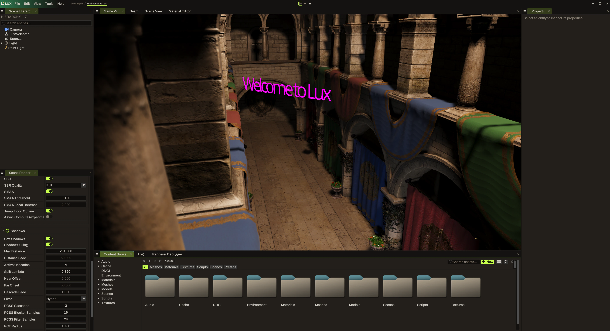

LUXENGINE / THE WORKING NOTES

# Build it. Understand it.

LuxEngine is a C++ game engine and editor from Starbounded Studio. These guides are a place to start: get the source, build the tools, and understand what you're looking at.

The engine is still changing. The setup guide follows the public **`dev` branch**, which contains the current LuxEngine code. Older branches can use different project names and dependencies.

- **Start with the source**

    Get the prerequisites, run setup, and build the editor on Windows.

    [Build LuxEngine →](getting-started.md)

- **Find your way around**

    Meet the scene hierarchy, viewport, content browser, and material editor.

    [Explore the editor →](editor.md)

- **Look closer at rendering**

    Work through the lighting and material test scenes, one change at a time.

    [Rendering & materials →](rendering.md)

- **Help with the next problem**

    Report an issue, share a reproducible test, or improve a guide.

    [Contribute →](contributing.md)

## A look inside

*A real development capture: the scene, hierarchy, rendering controls, and content browser in one workspace. Your checkout may look different as the editor evolves.*

## If something gets in the way

Start with [troubleshooting](troubleshooting.md). If you're still stuck, include your branch, commit, setup output, and the steps that led to the problem in a [GitHub issue](https://github.com/starbounded-dev/LuxEngine/issues).

[Back to Starbounded Studio ↗](https://www.starbounded.com/)
