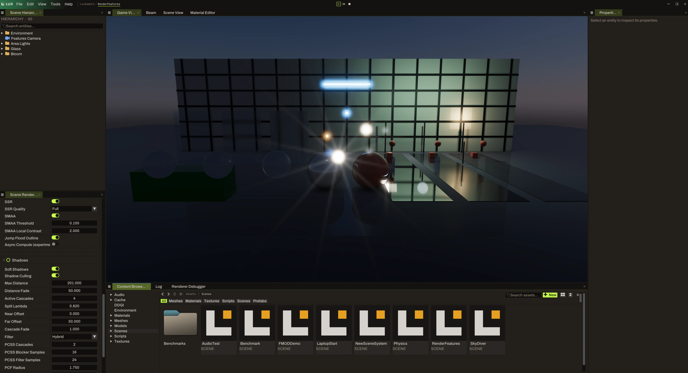

# Rendering and materials

LuxEngine renders with **Vulkan** through NVIDIA's [NRI](https://github.com/NVIDIA-RTX/NRI) abstraction. Only the Vulkan backend is built: there's no DirectX, Metal or OpenGL. Building needs the Vulkan 1.4 SDK, but the engine only needs a Vulkan 1.2 capable driver to run.

## What the renderer does

Sources: the "What works today" section of the [engine README](https://github.com/starbounded-dev/LuxEngine/blob/dev/README.md#what-works-today) and the render features merged into `dev` in October 2026 (PR 35).

**The frame.** Opaque geometry goes into a G-buffer, and lighting is computed in a deferred pass. Point and spot lights are culled per froxel cluster first, so each pixel only shades the lights that can reach it. Transparent surfaces draw afterwards in a separate forward pass, with glass refraction; two-sided transparents draw their back faces, then their front faces. A depth-only prepass runs first for opaque draws.

**The render graph.** Passes are declared in a render graph, which reuses scratch resources between passes and skips any pass whose feature is off. That's deliberate: an effect you've disabled should cost nothing.

**Lights.** Point, spot and directional lights, plus **area lights**: rect, disk, sphere and tube, shaded with Linearly Transformed Cosines. Lights use physical units.

**Shadows.** Cascaded shadow maps for the sun (2K by default) and shadow maps for spot lights. Cut-out materials cast alpha-tested shadows.

**Sky and ambient light.** A Preetham sky, or an HDR environment map converted to a cubemap with irradiance and prefiltered mips.

**Post-processing.** GTAO for ambient occlusion, screen-space reflections, FFT convolution bloom (which replaced the older mip-chain bloom, with glare kernel settings), depth of field, and SMAA for anti-aliasing. A hierarchical depth buffer feeds occlusion culling and SSR.

**Exposure and tonemapping.** Exposure can be a manual multiplier, a manual EV100, a physical camera (aperture, shutter speed and ISO) or histogram auto-exposure. Tonemapping is ACES or AgX.

**Materials.** The Material Editor edits surface, emission, translucency, texture maps and UVs; see [the editor guide](editor.md#looking-at-a-material). Materials can be cut out (alpha-tested, with alpha coverage kept at every mip) or two-sided, and they support diffuse transmission, so light passes through thin surfaces like leaves (glTF's `KHR_materials_diffuse_transmission`).

**GPU-driven pieces.** Scene data lives in GPU buffers, and meshes are culled in a compute pass. Each pass records its own GPU time; see [Profiling](profiling.md).

**2D.** A batch renderer draws sprites, circles, lines and MSDF text, for 2D games and for world-space text in 3D.

**In the editor.** Selection outlines (jump flood), a depth-tested collider view, wireframe, G-buffer and AO debug views, a light complexity view, and an infinite grid.

### What it doesn't do

- **No temporal techniques.** There's no TAA and no temporal upscaler, and that's a standing rule for the engine, not a gap: anti-aliasing is SMAA. Sky atmosphere and volumetric clouds were removed during a renderer simplification pass.
- **No ray tracing and no global illumination** beyond the sky light. Both are planned to restart from scratch after 2027.1.
- **No fog, decals or reflection probes yet.** All three are wanted for 2027.1.
- **Tested on one GPU so far.** Most recorded measurements come from an NVIDIA RTX 4070 Ti. Testing on AMD and Intel is must-have M9 for 2027.1.

Area light shadows and much of the material work are built but haven't all been run in the editor yet; the 2027.1 hardening pass (M1) covers them. If something looks wrong there, report it.

## Looking at rendering changes

Small scenes make rendering changes easier to understand. A simple arrangement of lights, materials, and surfaces can reveal a problem that is hard to isolate in a larger scene.

This development capture shows the `RenderFeatures` scene. It places bright emitters, spheres, upright panels, and reflective surfaces in the same view. These are useful subjects for comparing lighting, material appearance, reflections, and bright highlights.

The screenshot documents one development build, not a guarantee that every branch has the same scene or controls. These guides follow the engine's [`dev` branch](https://github.com/starbounded-dev/LuxEngine/tree/dev); record the exact revision you are using.

## Make a comparison you can repeat

1. Record the engine branch and commit, scene name, camera view, and build configuration.
2. Capture the starting view and the relevant material and rendering settings.
3. Change one setting or one part of the scene.
4. Capture the result from the same view.
5. Restore the starting state before testing a different change.

Keep window size and resolution consistent when comparing images. If the problem only appears with a particular camera angle or distance, include both the failing view and a nearby view that looks correct.

## Controls visible in the captures

The scene rendering panel shows controls for **SSR**, **SMAA**, and **shadows**. The material-editor capture also shows **GTAO** resolution and denoise settings. Shadow controls include soft shadows, culling, distance, cascades, and filtering options.

Treat the labels as a way to identify the settings used in a test. Available options and their implementation may change, so there is no universal recommended preset here. When a change looks wrong, note the exact option and value rather than describing it only as “high” or “default.”

## Useful things to compare

| Subject | What to record |
| --- | --- |
| Bright emitters | Material name, emission color and intensity, and whether the issue appears in the material preview, the scene, or both. |
| Reflections | Camera position, the surface and object involved, and the SSR setting shown in your build. |
| Shadows | Light and object arrangement, relevant shadow settings, and the distance at which the result changes. |
| Edges | Viewport resolution, SMAA state, and an image that shows the affected edge clearly. |
| Material appearance | Surface values, assigned texture maps, and the lighting used for the comparison. |

A screenshot can show appearance, but it cannot establish performance. If a report concerns frame time or resource use, describe how you measured it and include the hardware, driver, resolution, and build configuration.

## Report the smallest useful example

Try to reduce a rendering problem to one scene, one view, and a short set of steps. Attach the comparison images and list the settings you changed. If you can share the scene or a small asset that reproduces the issue, explain any dependencies it needs.

See [Contributing](contributing.md) for a report checklist, or open an [engine issue](https://github.com/starbounded-dev/LuxEngine/issues).
