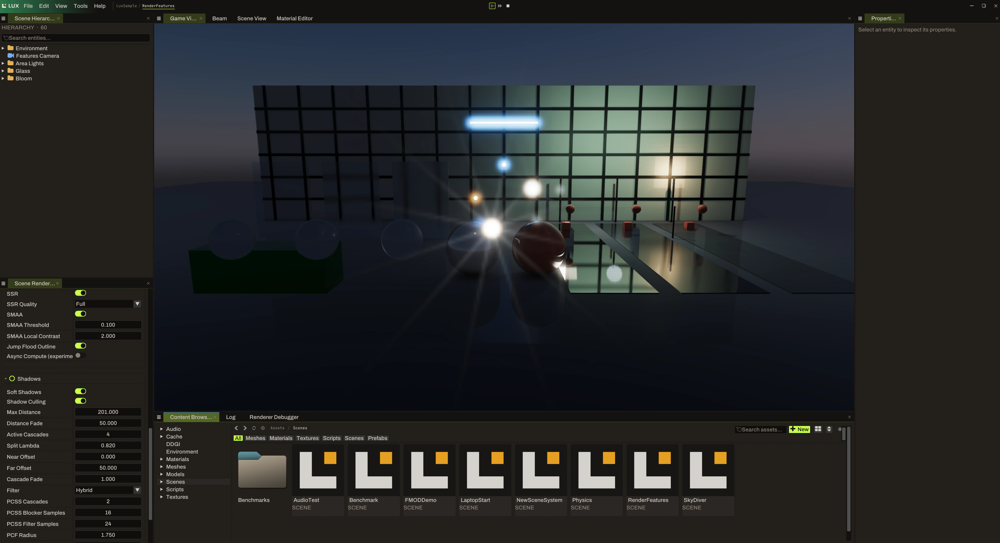

# Looking at rendering changes

Small scenes make rendering changes easier to understand. A simple arrangement of lights, materials, and surfaces can reveal a problem that is hard to isolate in a larger scene.

This development capture shows the `RenderFeatures` scene. It places bright emitters, spheres, upright panels, and reflective surfaces in the same view. These are useful subjects for comparing lighting, material appearance, reflections, and bright highlights.

The screenshot documents one development build, not a guarantee that every branch has the same scene or controls. These guides follow the engine's [`dev` branch](https://github.com/starbounded-dev/LuxEngine/tree/dev); record the exact revision you are using.

## Make a comparison you can repeat

1. Record the engine branch and commit, scene name, camera view, and build configuration.
2. Capture the starting view and the relevant material and rendering settings.
3. Change one setting or one part of the scene.
4. Capture the result from the same view.
5. Restore the starting state before testing a different change.

Keep window size and resolution consistent when comparing images. If the problem only appears with a particular camera angle or distance, include both the failing view and a nearby view that looks correct.

## Controls visible in the captures

The scene rendering panel shows controls for **SSR**, **SMAA**, and **shadows**. The material-editor capture also shows **GTAO** resolution and denoise settings. Shadow controls include soft shadows, culling, distance, cascades, and filtering options.

Treat the labels as a way to identify the settings used in a test. Available options and their implementation may change, so there is no universal recommended preset here. When a change looks wrong, note the exact option and value rather than describing it only as “high” or “default.”

## Useful things to compare

| Subject | What to record |
| --- | --- |
| Bright emitters | Material name, emission color and intensity, and whether the issue appears in the material preview, the scene, or both. |
| Reflections | Camera position, the surface and object involved, and the SSR setting shown in your build. |
| Shadows | Light and object arrangement, relevant shadow settings, and the distance at which the result changes. |
| Edges | Viewport resolution, SMAA state, and an image that shows the affected edge clearly. |
| Material appearance | Surface values, assigned texture maps, and the lighting used for the comparison. |

A screenshot can show appearance, but it cannot establish performance. If a report concerns frame time or resource use, describe how you measured it and include the hardware, driver, resolution, and build configuration.

## Report the smallest useful example

Try to reduce a rendering problem to one scene, one view, and a short set of steps. Attach the comparison images and list the settings you changed. If you can share the scene or a small asset that reproduces the issue, explain any dependencies it needs.

See [Contributing](contributing.md) for a report checklist, or open an [engine issue](https://github.com/starbounded-dev/LuxEngine/issues).
